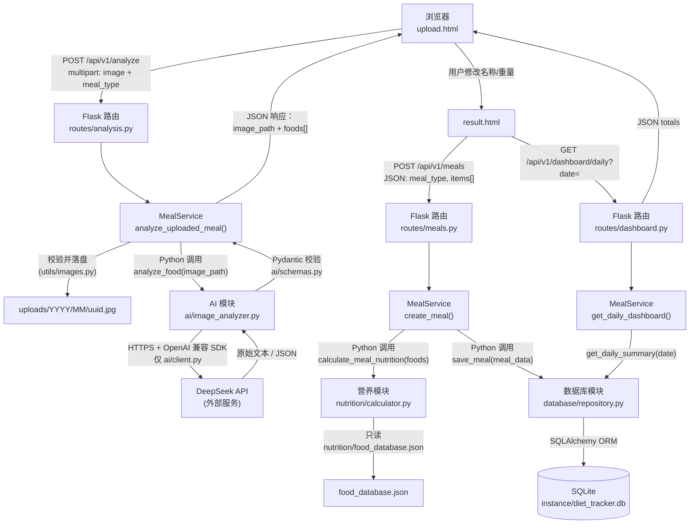

# 00 — 主技术路线

**这是五名成员共同遵守的权威规范。**
任何成员文档若与本文件冲突，**以本文件为准**。要改接口，必须先在这里改，并经全组确认。

- 项目：Healthy Diet Tracker（本地浏览器应用）
- 团队：5 名开发者 · 6 周 · 具备 Python/HTML/JS 基础
- 架构：模块化单体——一个 Flask 应用，内部按 Python 包分模块
- 数据契约版本：`1.0`
- API 版本：`v1`

---

## A. 系统架构

### A.1 分层

```
浏览器（HTML/CSS/JS + Chart.js）
        │  HTTP + JSON  /  multipart/form-data
        ▼
Flask 路由层        ← 很薄：解析请求 → 调服务 → 序列化响应
        │  Python 函数调用
        ▼
服务层              ← 编排：校验 → 调各模块 → 组装 → 提交事务
   │            │            │
   ▼            ▼            ▼
AI 模块      营养模块      数据库模块
(图片→JSON)  (JSON→数字)   (SQLAlchemy→SQLite)
```

### A.2 端到端流程

**AI 永远不负责算卡路里；营养引擎永远不许调 AI；前端永远不许直连数据库或 AI 供应商；AI 模块不做图片预处理（校验/缩放/EXIF/落盘全部由成员1 的 `utils/images.py` 一次性完成，AI 模块拿到的 `image_path` 已经是可直接使用的最终文件）。**



### A.3 通信方式矩阵

| 从 | 到 | 方式 | 允许？ |
|---|---|---|---|
| 浏览器 | Flask | HTTP + JSON（`fetch`） | 允许 |
| 浏览器 | Flask 上传 | `multipart/form-data` | 允许 |
| Flask 路由 | 服务层 | Python 函数调用 | 允许 |
| 服务层 | AI 模块 | Python 函数调用 | 允许 |
| 服务层 | 营养模块 | Python 函数调用 | 允许 |
| 服务层 | 数据库模块 | Python 函数调用 | 允许 |
| AI 模块 | DeepSeek API | HTTPS（OpenAI 兼容 SDK） | 允许——**仅限 `ai/client.py` 内部** |
| 营养模块 | `food_database.json` | 读本地文件（缓存） | 允许 |
| 数据库模块 | SQLite | SQLAlchemy ORM | 允许 |
| 营养模块 | AI 模块 | — | **禁止** |
| 浏览器 | 数据库 / AI / DeepSeek / OpenAI | — | **禁止** |
| AI 模块 | 营养模块 | — | **禁止** |
| AI 模块 | Pillow / 图片缩放 / EXIF | — | **禁止**——AI 模块只接收已处理好的 `image_path` |

### A.4 为什么必须把 AI 和营养拆开

| 关注点 | AI 负责 | 我们自己的代码负责 |
|---|---|---|
| "这是米饭还是面条？" | ✅ | ❌ |
| "大概多少克？" | ✅ | ❌ |
| "180 克等于多少千卡？" | ❌ | ✅ |
| "同样输入永远得到同样数字？" | ❌（大模型不确定） | ✅（纯函数） |

正因为这样拆，营养模块才能精确到小数位做单元测试，整条流水线也能不花钱、不联网就测通。

---

## B. 技术选型

| 技术 | 版本 | 承担什么 | 为什么不用别的 |
|---|---|---|---|
| Python | 3.11+ | 运行时 | 需要 Flask、Pydantic v2、`str \| None` 类型写法 |
| Flask | 3.x | HTTP 服务、路由、模板 | 本地同时提供 HTML 和 JSON 最轻的方案，无前端构建步骤 |
| HTML/CSS/原生 JS | — | 界面 | 团队已会；上框架会引入没人会用的构建工具链 |
| DeepSeek API（`openai` SDK，OpenAI 兼容） | 最新 | 图片 → 结构化 JSON | MVP 只选一家；`deepseek-flash` 支持图片输入与强制 JSON 输出；国内可直连 |
| Pydantic | v2 | 校验跨模块数据 | 把"契约"变成可运行的断言 |
| SQLite | 3 | 本地持久化 | 零安装、单文件、6 周个人数据量完全够 |
| SQLAlchemy / Flask-SQLAlchemy | 2.x / 3.x | SQLite 之上的 ORM | 关系与级联开箱即用，免去到处手写 SQL |
| Chart.js | 4.x | 仪表盘图表 | 一个 `<script>` 标签，无需打包器 |
| pytest | 8.x | 自动化测试 | 事实标准；`test_client` 与 Flask 集成干净 |
| python-dotenv | 1.x | 把 `.env` 读进环境变量 | 让 API Key 不进源码 |
| Git + GitHub | — | 协作 | 分支/PR 流程本身就是考核项 |

**明确不用**：React、Vue、Node.js、Docker、Redis、Celery、微服务、消息队列、Alembic 迁移、用户鉴权与账号体系。

### B.1 统一 `requirements.txt`

```text
Flask>=3.0
Flask-SQLAlchemy>=3.1
SQLAlchemy>=2.0
openai>=3.0,<4.0
pydantic>=2.6
Pillow>=10.0
python-dotenv>=1.0
pytest>=8.0
```

> 各成员文档分别列出自己的子集，但实际安装必须用这份完整清单。`openai` 是访问 DeepSeek 官方 API 的客户端（OpenAI 兼容格式，只改 `base_url` 与 `model`）；自 2026 年起项目不再使用 `google-genai`。

---

## C. 完整目录结构

```text
healthy-diet-tracker/
├── run.py                              # 入口：python run.py → http://127.0.0.1:5000
├── requirements.txt                    # 依赖清单
├── .env.example                        # 只有变量名，无真实密钥（提交到 Git）
├── .env                                # 真实密钥（绝不提交）
├── .gitignore
├── README.md                           # 本套文档之 FILE 1
│
├── docs/
│   ├── 00_MAIN_TECHNICAL_ROUTE.md      # FILE 2 —— 本文件，最高权威
│   ├── 01_BACKEND_DEVELOPER.md         # FILE 3
│   ├── 02_AI_INTEGRATION_DEVELOPER.md  # FILE 4
│   ├── 03_NUTRITION_ENGINE_DEVELOPER.md# FILE 5
│   ├── 04_FRONTEND_DEVELOPER.md        # FILE 6
│   ├── 05_DATABASE_AND_TESTING_DEVELOPER.md # FILE 7
│   └── PORTION_EVAL.md                 # 成员2——30 张照片识别/份量误差回归表（第 5 周，选做）
│
├── app/
│   ├── __init__.py                     # create_app()——应用工厂（成员1）
│   ├── config.py                       # Config 类，读 .env（成员1）
│   ├── extensions.py                   # db = SQLAlchemy()（成员5）
│   │
│   ├── routes/                         # 成员1——薄 HTTP 层
│   │   ├── __init__.py                 # register_blueprints(app)
│   │   ├── pages.py                    # GET /、/upload、/result、/history（渲染模板）
│   │   ├── analysis.py                 # POST /api/v1/analyze
│   │   ├── meals.py                    # /api/v1/meals（POST、GET、GET/{id}、DELETE/{id}）
│   │   └── dashboard.py                # GET /api/v1/dashboard/daily
│   │
│   ├── services/                       # 成员1——只做编排
│   │   ├── __init__.py
│   │   ├── meal_service.py             # 见 §G.3
│   │   └── schemas.py                  # 请求体 Pydantic 模型（CreateMealRequest、MealItemInput）
│   │
│   ├── ai/                             # 成员2
│   │   ├── __init__.py
│   │   ├── client.py                   # 唯一允许 import openai 的文件
│   │   ├── image_analyzer.py           # analyze_food(image_path) -> dict
│   │   ├── prompts.py                  # PROMPT_TEMPLATE 常量
│   │   └── schemas.py                  # AIAnalysis、DetectedFood
│   │
│   ├── nutrition/                      # 成员3
│   │   ├── __init__.py
│   │   ├── calculator.py               # calculate_meal_nutrition(foods) -> dict
│   │   ├── food_matcher.py             # match_food(food_name) -> dict | None
│   │   ├── food_repository.py          # load_food_index()——缓存读取 JSON
│   │   ├── food_database.json          # 20–30 条参考食物（每 100 g）
│   │   └── schemas.py                  # NutritionItem、NutritionResult（必须有）
│   │
│   ├── database/                       # 成员5
│   │   ├── __init__.py
│   │   ├── models.py                   # Food、Meal、MealItem
│   │   └── repository.py               # save_meal、get_meal、get_meals、delete_meal、get_daily_summary
│   │
│   ├── utils/                          # 成员1（images/errors/timeutil），他人只读
│   │   ├── __init__.py
│   │   ├── errors.py                   # ApiError 体系 + 错误码常量
│   │   ├── images.py                   # 校验 / EXIF 方向修正 / 缩放 / 落盘
│   │   └── timeutil.py                 # UTC ↔ APP_TIMEZONE，推导 meal_date
│   │
│   ├── templates/                      # 成员4
│   │   ├── base.html
│   │   ├── index.html
│   │   ├── upload.html
│   │   ├── result.html
│   │   └── history.html
│   │
│   └── static/                         # 成员4
│       ├── css/style.css
│       └── js/
│           ├── api.js                  # apiFetch()——全站唯一写 fetch() 的地方
│           ├── upload.js
│           ├── result.js
│           ├── dashboard.js
│           └── history.js
│
├── tests/                              # 成员5 主责，各模块自己补
│   ├── conftest.py                     # app / client / db 夹具
│   ├── fixtures/
│   │   ├── mock_ai_result.json
│   │   ├── mock_ai_partial.json
│   │   ├── photos.json                 # 照片清单（成员2）：file / dish / note，回归脚本读它
│   │   ├── sample_meal.jpg
│   │   └── photos/                     # 真实照片，Git 忽略（清单里登记，文件本地保留）
│   ├── unit/
│   │   ├── test_calculator.py          # 成员3
│   │   ├── test_food_matcher.py        # 成员3
│   │   ├── test_ai_schema.py           # 成员2
│   │   ├── test_ai_client.py           # 成员2——供应商适配（打桩，不联网）
│   │   ├── test_repository.py          # 成员5
│   │   └── test_api.py                 # 成员1
│   ├── integration/
│   │   ├── test_pipeline.py            # 成员5
│   │   └── test_api_errors.py          # 成员1 + 成员5
│   └── e2e/
│       └── test_workflow.py            # 成员5
│
├── scripts/
│   ├── init_db.py                      # 成员5——create_all()
│   ├── seed_foods.py                   # 成员5——幂等导入 JSON → DB
│   └── evaluate_portions.py            # 成员2（+成员5）——MAPE 实验，选做
│
├── instance/                           # SQLite 文件（Git 忽略）
│   └── .gitkeep
└── uploads/                            # 上传的图片（Git 忽略）
    └── .gitkeep
```

### C.1 文件归属（不许重叠）

| 路径 | 所有者 | 他人可以 | 他人**不可以** |
|---|---|---|---|
| `run.py`、`app/__init__.py`、`app/config.py` | 成员1 | 阅读 | 未经告知就改 |
| `app/routes/**`、`app/services/**` | 成员1 | 通过 HTTP 调接口 | 把模块内部逻辑搬进路由 |
| `app/utils/errors.py`、`images.py`、`timeutil.py` | 成员1 | import 使用 | 在别处重复实现同一逻辑 |
| `app/ai/**` | 成员2 | 只调 `analyze_food()` | import `ai.client`、改提示词 |
| `app/nutrition/**` | 成员3 | 调 `calculate_meal_nutrition()`、`match_food()` | 悄悄改 `food_database.json` 里的数值 |
| `app/templates/**`、`app/static/**` | 成员4 | 阅读 | 在 JS 里写业务逻辑 |
| `app/database/**`、`app/extensions.py`、`scripts/init_db.py`、`scripts/seed_foods.py` | 成员5 | 调仓储函数 | 未经契约变更就改模型 |
| `tests/unit/test_calculator.py` 等 | 对应模块所有者 | — | 删别人的测试 |
| `tests/conftest.py`、`tests/fixtures/**` | 成员5 | 通过 PR 增加夹具 | 破坏已有夹具 |
| `docs/**` | 全组 | 谁都可以提 PR | 单方面修改契约 |

---

## D. 全局数据约定

| 约定 | 规则 |
|---|---|
| JSON 字段名 | `snake_case`，全小写 |
| 编码 | 全链路 UTF-8（文件、HTTP、数据库文本） |
| 重量 | 克（g），字段名以 `_g` 结尾 |
| 能量 | 千卡（kcal），字段名以 `_kcal` 结尾 |
| 宏量营养素 | 克（g）：`protein_g` / `carbs_g` / `fat_g` |
| 置信度 | 浮点 `0.0–1.0`，字段名 `confidence` |
| 时间戳（接口层） | ISO 8601 **带偏移量**，如 `2026-11-01T12:30:00+08:00` |
| 时间戳（数据库） | UTC 文本以 `Z` 结尾，如 `2026-11-01T04:30:00Z` |
| 日期 | `YYYY-MM-DD`，本地日期（见 §D.1） |
| 缺失值 | `null`——绝不用 `""`、`"unknown"`、`0` 冒充 |
| 布尔值 | JSON 用 `true`/`false`；SQLite 整数列用 `0`/`1` |
| ID | 数据库行用整数（`meal_id`、`food_id`）；不透明令牌用字符串 |
| API 版本 | URL 前缀 `/api/v1`；破坏性变更走 `/api/v2` |
| Schema 版本 | 每份跨模块 JSON 都带 `"schema_version": "1.0"` |
| 取整 | `calories_kcal` 1 位小数；宏量营养素 2 位；合计只在最后取整一次 |
| 时区 | 环境变量 `APP_TIMEZONE`，默认 `Asia/Shanghai` |

### D.1 时间处理（最容易出错的地方）

SQLite 没有时区类型，所以：

1. **入参**——接口接受带偏移量的 ISO 8601；缺偏移量就按 `APP_TIMEZONE` 解释。
2. **存储**——转成 UTC 文本存 `meal_datetime_utc`（以 `Z` 结尾）；同时按 `APP_TIMEZONE` 算出**本地日期** `meal_date`（`YYYY-MM-DD`）一并存。
3. **为什么要多一列**——"今天吃了多少"必须能用一次带索引的等值查询（`WHERE meal_date = '2026-11-01'`）解决，而不是在 SQL 里逐行做时区换算。
4. **出参**——从 UTC 转回 `APP_TIMEZONE`，输出带偏移量的字符串。

### D.2 取整规则

```
单项值 = weight_g / 100 * 每100克数值      # 不取整
合计   = 各单项未取整值之和                 # 不取整
最后：calories_kcal → round(x, 1)
      protein_g / carbs_g / fat_g → round(x, 2)
```

**不要**把已经取整的值相加——误差会累积，单元测试会随机变红。

---

## E. 共享 JSON 数据契约

下面六份契约是**唯一合法形状**。所有文档与代码里的字段名必须与之一字不差。

### E.1 契约 A —— AI 识别输出（`analyze_food()` 返回值）

```json
{
  "schema_version": "1.0",
  "status": "success",
  "foods": [
    {
      "food_name": "cooked_white_rice",
      "display_name": "White rice",
      "estimated_weight_g": 180.0,
      "confidence": 0.95,
      "notes": null
    },
    {
      "food_name": "grilled_chicken_breast",
      "display_name": "Grilled chicken breast",
      "estimated_weight_g": 120.0,
      "confidence": 0.88,
      "notes": "Estimated portion"
    }
  ],
  "warnings": []
}
```

| 字段 | 类型 | 必填 | 单位 | 含义 | 示例 | 校验 |
|---|---|---|---|---|---|---|
| `schema_version` | string | 是 | — | 契约版本 | `"1.0"` | 必须等于 `"1.0"` |
| `status` | string | 是 | — | 识别结果状态 | `"success"` | `success` / `partial` / `error` 三选一 |
| `foods` | array | 是 | — | 识别出的食物 | `[...]` | `0–20` 项 |
| `foods[].food_name` | string \| null | 是 | — | 用于查库的标准 ID | `"cooked_white_rice"` | `^[a-z0-9_]+$`，≤60 字符；认不出填 `null` |
| `foods[].display_name` | string | 是 | — | 给用户看的名字 | `"White rice"` | 1–100 字符，可中文 |
| `foods[].estimated_weight_g` | number \| null | 是 | g | 可食用部分估计重量 | `180.0` | `0 < x ≤ 5000`；估不出填 `null` |
| `foods[].confidence` | number | 是 | 0–1 | 识别置信度（不是份量精度） | `0.95` | `0 ≤ x ≤ 1` |
| `foods[].notes` | string \| null | 否 | — | 不确定性说明 | `"Estimated portion"` | ≤200 字符 |
| `warnings` | array[string] | 是 | — | 人类可读告警 | `["food_unrecognized: 酱汁"]` | 无告警填 `[]`，不许 `null` |

**刻意省略**：契约 A **没有** `meal_type`。餐型由用户在浏览器选择、以表单字段传入，AI 从不决定餐型——这样 `analyze_food(image_path)` 的签名才能与规定完全一致。

**状态含义：**

| 情况 | `status` | `foods` | `warnings` |
|---|---|---|---|
| 每项都有 `food_name` 和重量 | `success` | 正常 | `[]` |
| 有项 `food_name: null` 或重量为 `null` | `partial` | 正常，缺的部分为 `null` | ≥1 条 |
| 一张图什么都认不出 | `error` | `[]` | ≥1 条 |

### E.2 契约 B —— 确认餐食输入（`POST /api/v1/meals` 请求体）

```json
{
  "meal_type": "lunch",
  "meal_datetime": "2026-11-01T12:30:00+08:00",
  "image_path": "uploads/2026/11/6f1c9a2e.jpg",
  "items": [
    { "food_name": "cooked_white_rice", "display_name": "White rice", "weight_g": 180.0 },
    { "food_name": "grilled_chicken_breast", "display_name": "Grilled chicken breast", "weight_g": 120.0 }
  ]
}
```

| 字段 | 类型 | 必填 | 单位 | 含义 | 校验 |
|---|---|---|---|---|---|
| `meal_type` | string | 是 | — | 餐型 | `breakfast` / `lunch` / `dinner` / `snack` |
| `meal_datetime` | string | 是 | — | 用餐时间 | ISO 8601 带偏移；不得晚于当前 1 天以上 |
| `image_path` | string \| null | 否 | — | `/analyze` 返回的路径，原样回传 | 必须是 `uploads/` 下的相对路径，不含 `..`，文件须存在；否则按 `null` 处理 |
| `items` | array | 是 | — | 用户修正后的食物列表 | `1–20` 项 |
| `items[].food_name` | string \| null | 是 | — | 修正后的标准 ID | 允许 `null`（视为未匹配） |
| `items[].display_name` | string | 是 | — | 最终展示名 | 1–100 字符 |
| `items[].weight_g` | number | 是 | g | 最终重量 | `0 < x ≤ 5000` |

**不接受**：`calories_kcal`、`protein_g`、`carbs_g`、`fat_g`、`totals`。客户端就算传了也**一律忽略**，服务端重新计算。

### E.3 契约 C —— 营养计算结果（`calculate_meal_nutrition()` 返回值）

```json
{
  "schema_version": "1.0",
  "items": [
    {
      "food_name": "cooked_white_rice",
      "display_name": "White rice",
      "weight_g": 180.0,
      "calories_kcal": 234.0,
      "protein_g": 4.86,
      "carbs_g": 50.76,
      "fat_g": 0.54,
      "food_data_source": "USDA"
    },
    {
      "food_name": "grilled_chicken_breast",
      "display_name": "Grilled chicken breast",
      "weight_g": 120.0,
      "calories_kcal": 198.0,
      "protein_g": 37.2,
      "carbs_g": 0.0,
      "fat_g": 4.32,
      "food_data_source": "USDA"
    }
  ],
  "totals": {
    "calories_kcal": 432.0,
    "protein_g": 42.06,
    "carbs_g": 50.76,
    "fat_g": 4.86
  },
  "warnings": []
}
```

| 字段 | 类型 | 必填 | 单位 | 含义 | 校验 |
|---|---|---|---|---|---|
| `schema_version` | string | 是 | — | `"1.0"` | 必须等于 |
| `items` | array | 是 | — | **只含计算成功的项** | 可为 `[]` |
| `items[].food_name` | string | 是 | — | 命中的标准 ID | 非空 |
| `items[].display_name` | string | 是 | — | 透传的展示名 | 1–100 字符 |
| `items[].weight_g` | number | 是 | g | 输入重量 | `0 < x ≤ 5000` |
| `items[].calories_kcal` | number | 是 | kcal | 计算出的能量 | `≥ 0`，1 位小数 |
| `items[].protein_g` / `carbs_g` / `fat_g` | number | 是 | g | 计算出的宏量营养素 | `≥ 0`，2 位小数 |
| `items[].food_data_source` | string | 是 | — | 数据来源 | `USDA` / `local` / `custom` |
| `totals` | object | 是 | — | `items` 之和 | 固定四键，恒存在 |
| `warnings` | array[string] | 是 | — | 被跳过项说明 | 无则 `[]` |

**规则**：未匹配或缺重量的食物**不进 `items`**，只进 `warnings`，前缀固定三种：`food_not_matched: <name>`、`missing_weight: <name>`、`invalid_weight: <name>`。

### E.4 契约 D —— 数据库餐食记录（`get_meal()` 返回值 / `POST /meals` 的 `data`）

```json
{
  "meal_id": 101,
  "meal_type": "lunch",
  "meal_datetime": "2026-11-01T12:30:00+08:00",
  "meal_date": "2026-11-01",
  "image_path": "uploads/2026/11/6f1c9a2e.jpg",
  "created_at": "2026-11-01T04:30:12Z",
  "items": [
    {
      "food_name": "cooked_white_rice",
      "display_name": "White rice",
      "weight_g": 180.0,
      "calories_kcal": 234.0,
      "protein_g": 4.86,
      "carbs_g": 50.76,
      "fat_g": 0.54,
      "food_data_source": "USDA"
    }
  ],
  "totals": {
    "calories_kcal": 234.0,
    "protein_g": 4.86,
    "carbs_g": 50.76,
    "fat_g": 0.54
  },
  "warnings": []
}
```

| 字段 | 类型 | 必填 | 单位 | 含义 | 校验 |
|---|---|---|---|---|---|
| `meal_id` | integer | 是 | — | 主键 | `> 0` |
| `meal_type` | string | 是 | — | 四值枚举 | 同 E.2 |
| `meal_datetime` | string | 是 | — | 带偏移的本地时间 | ISO 8601 |
| `meal_date` | string | 是 | — | 用于筛选的本地日期 | `YYYY-MM-DD` |
| `image_path` | string \| null | 是 | — | 相对路径或 `null` | 不允许绝对路径 |
| `created_at` | string | 是 | — | 行创建时间（UTC） | ISO 8601 以 `Z` 结尾 |
| `items` | array | 是 | — | 快照明细 | `1–20` 项 |
| `items[*]` | object | 是 | — | 形状与 E.3 `items` 完全一致 | 读取时**绝不重算** |
| `totals` | object | 是 | — | 各项快照之和 | 固定四键 |
| `warnings` | array[string] | 是 | — | 保存时产生的告警 | 无则 `[]` |

**快照原则**：`items[*]` 的数值在保存那一刻冻结。以后改 `food_database.json` **不得**改变历史餐食。

### E.5 契约 E —— 每日仪表盘响应（`GET /api/v1/dashboard/daily` 的 `data`）

```json
{
  "date": "2026-11-01",
  "totals": {
    "calories_kcal": 1650.0,
    "protein_g": 80.0,
    "carbs_g": 190.0,
    "fat_g": 55.0
  },
  "meal_count": 3,
  "by_meal_type": {
    "breakfast": 350.0,
    "lunch": 780.0,
    "dinner": 520.0,
    "snack": 0.0
  }
}
```

| 字段 | 类型 | 必填 | 单位 | 含义 | 校验 |
|---|---|---|---|---|---|
| `date` | string | 是 | — | 回显的本地日期 | `YYYY-MM-DD` |
| `totals` | object | 是 | — | 当日合计，空数据全 0 | 固定四键，`≥ 0` |
| `meal_count` | integer | 是 | — | 当日餐数 | `≥ 0` |
| `by_meal_type` | object | 否 | kcal | 各餐型卡路里小计 | 固定四键，可省略 |

空数据日 ⇒ `200` + 全 0。**绝不**返回 404——"今天还没吃"不是错误。

### E.6 契约 F —— 标准错误响应

```json
{
  "status": "error",
  "error": {
    "code": "INVALID_IMAGE",
    "message": "The uploaded file is not a supported image.",
    "details": null
  }
}
```

| 字段 | 类型 | 必填 | 含义 | 校验 |
|---|---|---|---|---|
| `status` | string | 是 | 固定 `"error"` | 固定值 |
| `error.code` | string | 是 | 机器可读枚举（§H.1） | 必须在表中 |
| `error.message` | string | 是 | 简短英文说明 | ≤200 字符，不含堆栈 |
| `error.details` | object \| null | 是 | 补充上下文（`field`、`value`、`missing`） | 不得含密钥或堆栈 |

成功响应用并行的信封：

```json
{ "status": "success", "data": { } }
```

`data` 永远是对象；列表要包一层：`data.meals`、`data.items`。

### E.7 契约兼容性核对表

| 生产方 → 消费方 | 载荷 | 必须符合 |
|---|---|---|
| AI → 服务层 | 契约 A | §E.1 |
| 浏览器 → `/analyze` | multipart `image` + `meal_type` | §F.1 |
| 浏览器 → `/meals` | 契约 B | §E.2 |
| 营养 → 服务层/数据库 | 契约 C | §E.3 |
| 数据库 → 服务层 → 浏览器 | 契约 D | §E.4 |
| 服务层 → 浏览器（看板） | 契约 E | §E.5 |
| 任何失败 | 契约 F | §E.6 |

---

## F. REST API 规范

Base URL `http://127.0.0.1:5000`，前缀 `/api/v1`，无鉴权（本地单用户应用）。

| # | 方法 | URL | 用途 | 成功码 |
|---|---|---|---|---|
| 1 | POST | `/api/v1/analyze` | 上传并分析餐食照片 | 200 |
| 2 | POST | `/api/v1/meals` | 保存已确认的餐食 | 201 |
| 3 | GET | `/api/v1/meals` | 查询餐食历史 | 200 |
| 4 | GET | `/api/v1/meals/{meal_id}` | 取单条餐食 | 200 |
| 5 | DELETE | `/api/v1/meals/{meal_id}` | 删除一条餐食 | 200 |
| 6 | GET | `/api/v1/dashboard/daily` | 每日营养摘要 | 200 |

v1 **没有** `PATCH`/`PUT`。编辑发生在浏览器里、**保存之前**，然后用修正后的数据 `POST /api/v1/meals`。这样接口恰好六个（MVP 纪律）。"保存后再改"是 v1 明确的非目标——删掉重存即可。

### F.1 POST /api/v1/analyze

| 项 | 值 |
|---|---|
| 方法 / URL | `POST /api/v1/analyze` |
| 请求格式 | `multipart/form-data`（**不是**把 base64 塞进 JSON） |
| 鉴权 | 无 |

| 表单字段 | 类型 | 必填 | 校验 |
|---|---|---|---|
| `image` | file | 是 | JPEG/PNG/WebP；≤ 8 MB；Pillow 能打开 |
| `meal_type` | string | 是 | `breakfast`/`lunch`/`dinner`/`snack` |

成功 `200`——`data` = 服务端图片路径 + 契约 A 平铺：

```json
{
  "status": "success",
  "data": {
    "image_path": "uploads/2026/11/6f1c9a2e.jpg",
    "schema_version": "1.0",
    "status": "success",
    "foods": [
      { "food_name": "cooked_white_rice", "display_name": "White rice",
        "estimated_weight_g": 180.0, "confidence": 0.95, "notes": null },
      { "food_name": "grilled_chicken_breast", "display_name": "Grilled chicken breast",
        "estimated_weight_g": 120.0, "confidence": 0.88, "notes": "Estimated portion" }
    ],
    "warnings": []
  }
}
```

请求示例：

```bash
curl -X POST http://127.0.0.1:5000/api/v1/analyze \
  -F "image=@tests/fixtures/sample_meal.jpg" \
  -F "meal_type=lunch"
```

错误：`400 INVALID_IMAGE`、`413 IMAGE_TOO_LARGE`、`415 UNSUPPORTED_MEDIA_TYPE`、`400 INVALID_REQUEST`（缺 `meal_type`）、`502 AI_PROVIDER_ERROR`、`502 INVALID_AI_RESPONSE`、`500 INTERNAL_ERROR`。

**注意**：照片部分或完全认不出来**不是** HTTP 错误。此时返回 `200`，`status` 为 `partial` 或 `error`，并填好 `warnings`。

### F.2 POST /api/v1/meals

| 项 | 值 |
|---|---|
| 方法 / URL | `POST /api/v1/meals` |
| 请求格式 | `application/json` |
| 请求体 | 契约 B（§E.2） |

请求示例：

```bash
curl -X POST http://127.0.0.1:5000/api/v1/meals \
  -H "Content-Type: application/json" \
  -d '{ "meal_type": "lunch",
        "meal_datetime": "2026-11-01T12:30:00+08:00",
        "image_path": "uploads/2026/11/6f1c9a2e.jpg",
        "items": [
          { "food_name": "cooked_white_rice", "display_name": "White rice", "weight_g": 180 },
          { "food_name": "grilled_chicken_breast", "display_name": "Grilled chicken breast", "weight_g": 120 }
        ] }'
```

成功 `201`——`data` = 契约 D（§E.4）。

错误：`400 INVALID_REQUEST`、`422 INVALID_WEIGHT`、`422 FOOD_NOT_FOUND`（**仅当**全部条目都匹配失败）、`500 DATABASE_ERROR`。

**部分成功**：只要有一项匹配成功，就保存，返回 `201`，并在 `data.warnings` 里列出被跳过的名字。**不许**偷偷替换食物或份量。

### F.3 GET /api/v1/meals

| 查询参数 | 类型 | 必填 | 默认 | 校验 |
|---|---|---|---|---|
| `date_from` | string | 否 | — | `YYYY-MM-DD`，本地日期 |
| `date_to` | string | 否 | — | `YYYY-MM-DD`，`>= date_from` |
| `limit` | integer | 否 | 50 | `1–200` |
| `offset` | integer | 否 | 0 | `>= 0` |

规则：两个日期都不给 ⇒ 返回全部，按时间倒序。只给其中一个 ⇒ `400 INVALID_REQUEST`。

成功 `200`：

```json
{
  "status": "success",
  "data": {
    "meals": [
      {
        "meal_id": 101,
        "meal_type": "lunch",
        "meal_datetime": "2026-11-01T12:30:00+08:00",
        "meal_date": "2026-11-01",
        "display_summary": "White rice, Grilled chicken breast",
        "calories_kcal": 432.0,
        "item_count": 2
      }
    ],
    "pagination": { "limit": 50, "offset": 0, "count": 1 }
  }
}
```

`display_summary` 由后端拼接：前三个 `display_name`，超出加 ` +N`。

示例：`GET /api/v1/meals?date_from=2026-11-01&date_to=2026-11-07&limit=20`

### F.4 GET /api/v1/meals/{meal_id}

成功 `200`——`data` = 契约 D（§E.4）。
错误：`400 INVALID_REQUEST`（非整数或 `<= 0`）、`404 MEAL_NOT_FOUND`。

### F.5 DELETE /api/v1/meals/{meal_id}

成功 `200`：

```json
{ "status": "success", "data": { "meal_id": 101, "deleted": true } }
```

行为：删除该餐及其明细（级联）。上传的图片文件**不删**（清理脚本属选做）。
错误：`404 MEAL_NOT_FOUND`、`500 DATABASE_ERROR`。

### F.6 GET /api/v1/dashboard/daily

| 查询参数 | 类型 | 必填 | 默认 | 校验 |
|---|---|---|---|---|
| `date` | string | 否 | `APP_TIMEZONE` 下的今天 | `YYYY-MM-DD` |

成功 `200`——`data` = 契约 E（§E.5）。空数据日 ⇒ 全 0，`200`。

### F.7 状态码映射

| HTTP | 何时使用 |
|---|---|
| 200 | 查询成功、分析成功、删除成功 |
| 201 | 餐食已创建 |
| 400 | 请求格式错误、图片内容无效、日期区间非法 |
| 404 | `meal_id` 不存在 |
| 405 | 该 URL 不支持此方法 |
| 413 | 上传超过 8 MB |
| 415 | MIME 不在白名单 |
| 422 | 语法合法但语义非法（重量、枚举、全部食物未匹配） |
| 500 | 数据库失败、未捕获异常 |
| 502 | AI 供应商失败或返回不可用响应 |

---

## G. Python 模块接口

以下八个签名**固定不变**。任何成员文档都不得重新定义；要改必须走 PR 修改本文件并全组签字。

```python
# app/ai/image_analyzer.py                       （成员2）
def analyze_food(image_path: str) -> dict:
    """返回契约 A（§E.1）。抛出 AiProviderError / InvalidAiResponse。"""

# app/nutrition/food_matcher.py                  （成员3）
def match_food(food_name: str) -> dict | None:
    """返回 food_database 条目 dict，找不到返回 None。仅精确匹配。"""

# app/nutrition/calculator.py                    （成员3）
def calculate_meal_nutrition(foods: list[dict]) -> dict:
    """输入：契约 A 的 foods 列表。返回契约 C（§E.3）。"""

# app/database/repository.py                     （成员5）
def save_meal(meal_data: dict) -> int:
    """输入：已校验的餐食 dict（契约 B + 已算好的 items）。返回新的 meal_id。"""

def get_meal(meal_id: int) -> dict | None:
    """返回契约 D（§E.4），不存在返回 None。"""

def get_meals(date_from: str | None = None, date_to: str | None = None) -> list[dict]:
    """返回历史摘要列表（F.3 的列表项），按时间倒序。None 表示不限。"""

def delete_meal(meal_id: int) -> bool:
    """删除该餐食及其全部明细（级联）。存在并删除成功返回 True，不存在返回 False。"""

def get_daily_summary(date: str) -> dict:
    """输入：本地日期 'YYYY-MM-DD'。返回契约 E（不含 by_meal_type）。"""
```

### G.1 详细输入输出

| 函数 | 输入 | 输出 | 异常 |
|---|---|---|---|
| `analyze_food(image_path)` | `str` 可读文件路径 | 契约 A dict | `AiProviderError`（超时/额度/网络）、`InvalidAiResponse`（JSON 坏/不符合 schema） |
| `match_food(food_name)` | `str` 候选 ID | 条目 dict（**键**：`food_name`、`display_name`、`calories_per_100g`、`protein_per_100g`、`carbs_per_100g`、`fat_per_100g`、`source`、`aliases`）或 `None` | 未知输入**不抛异常** |
| `calculate_meal_nutrition(foods)` | `list[dict]`（契约 A 的 items） | 契约 C dict | 仅当输入不是 list 时抛 `ValueError` |
| `save_meal(meal_data)` | `dict`，含 `meal_type`、`meal_datetime_utc`、`meal_date`、`image_path`、`items[]` | `int` meal_id | `DatabaseError` |
| `get_meal(meal_id)` | `int` | 契约 D 或 `None` | `DatabaseError` |
| `get_meals(date_from, date_to)` | 两个 `str \| None` | `list[dict]` 摘要 | `DatabaseError` |
| `delete_meal(meal_id)` | `int` | `bool`（存在并删除返回 `True`，不存在返回 `False`） | `DatabaseError` |
| `get_daily_summary(date)` | `str` `YYYY-MM-DD` | `dict`（契约 E 去掉 `by_meal_type`） | `DatabaseError` |

### G.2 允许使用的异常

```python
# app/utils/errors.py  （成员1）——各模块只管抛，路由统一翻译成 HTTP
class ApiError(Exception):
    def __init__(self, code: str, message: str, http_status: int = 400, details=None): ...

class InvalidImage(ApiError):
    """code=INVALID_IMAGE, http_status=400"""
    def __init__(self, message: str = "Invalid image.", details=None):
        super().__init__("INVALID_IMAGE", message, 400, details)

class ImageTooLarge(ApiError):
    """code=IMAGE_TOO_LARGE, http_status=413"""
    def __init__(self, message: str = "Image exceeds size limit.", details=None):
        super().__init__("IMAGE_TOO_LARGE", message, 413, details)

class UnsupportedMediaType(ApiError):
    """code=UNSUPPORTED_MEDIA_TYPE, http_status=415"""
    def __init__(self, message: str = "Unsupported media type.", details=None):
        super().__init__("UNSUPPORTED_MEDIA_TYPE", message, 415, details)

class InvalidRequest(ApiError):
    """code=INVALID_REQUEST, http_status=400"""
    def __init__(self, message: str = "Invalid request.", details=None):
        super().__init__("INVALID_REQUEST", message, 400, details)

class InvalidWeight(ApiError):
    """code=INVALID_WEIGHT, http_status=422"""
    def __init__(self, message: str = "Invalid weight value.", details=None):
        super().__init__("INVALID_WEIGHT", message, 422, details)

class FoodNotFound(ApiError):
    """code=FOOD_NOT_FOUND, http_status=422"""
    def __init__(self, message: str = "Food not found in database.", details=None):
        super().__init__("FOOD_NOT_FOUND", message, 422, details)

class MealNotFound(ApiError):
    """code=MEAL_NOT_FOUND, http_status=404"""
    def __init__(self, message: str = "Meal not found.", details=None):
        super().__init__("MEAL_NOT_FOUND", message, 404, details)

class AiProviderError(ApiError):
    """code=AI_PROVIDER_ERROR, http_status=502"""
    def __init__(self, message: str = "AI provider error.", details=None):
        super().__init__("AI_PROVIDER_ERROR", message, 502, details)

class InvalidAiResponse(ApiError):
    """code=INVALID_AI_RESPONSE, http_status=502"""
    def __init__(self, message: str = "Invalid AI response.", details=None):
        super().__init__("INVALID_AI_RESPONSE", message, 502, details)

class DatabaseError(ApiError):
    """code=DATABASE_ERROR, http_status=500"""
    def __init__(self, message: str = "Database error.", details=None):
        super().__init__("DATABASE_ERROR", message, 500, details)
```

各子类构造签名统一为 `(message, details=None)`——`code` 和 `http_status` 由子类硬编码，调用方只需传 `message` 与可选的 `details`。

模块层只抛异常；**只有** `routes/` 把它们翻译成 HTTP 响应体。模块不得 import Flask。

### G.3 服务层函数（成员1 拥有，不属于共享契约）

```python
# app/services/meal_service.py
def analyze_uploaded_meal(image_path: str, meal_type: str) -> dict
def create_meal(payload: dict) -> dict
def get_meal_detail(meal_id: int) -> dict
def list_meals(date_from: str | None, date_to: str | None, limit: int, offset: int) -> dict
def delete_meal(meal_id: int) -> dict
def get_daily_dashboard(date: str | None) -> dict
```

---

## H. 校验与错误处理

### H.1 错误码

| 错误码 | HTTP | 谁抛出 | 含义 | 客户端动作 |
|---|---|---|---|---|
| `INVALID_REQUEST` | 400 | 后端 | 请求体错误、缺字段、日期区间非法 | 修正请求；高亮对应输入 |
| `INVALID_IMAGE` | 400 | 后端 | 文件不是可解码图片 | 换一张照片 |
| `IMAGE_TOO_LARGE` | 413 | 后端 | 文件 > 8 MB | 压缩或重拍 |
| `UNSUPPORTED_MEDIA_TYPE` | 415 | 后端 | MIME 不在 JPEG/PNG/WebP | 只接受这三种 |
| `INVALID_WEIGHT` | 422 | 营养/后端 | 重量缺失、`<= 0`、`> 5000` | 用户必须填重量 |
| `FOOD_NOT_FOUND` | 422 | 营养 | 没有任何一项能匹配 | 让用户选择或手填 |
| `MEAL_NOT_FOUND` | 404 | 数据库/后端 | `meal_id` 不存在 | 回到列表页 |
| `AI_PROVIDER_ERROR` | 502 | AI | 超时、额度、供应商 5xx | 稍后重试 |
| `INVALID_AI_RESPONSE` | 502 | AI | AI 输出无法解析或缺字段 | 先重试一次，仍失败则报错 |
| `DATABASE_ERROR` | 500 | 数据库 | 读写失败 | 重试；记日志 |
| `INTERNAL_ERROR` | 500 | 后端 | 未捕获异常 | 通用提示；日志留堆栈 |

### H.2 各边界必须校验什么

| 边界 | 必须校验 | 违反时 |
|---|---|---|
| 浏览器 → `/analyze` | `image` 存在；MIME 白名单；≤8 MB；Pillow 能打开；`meal_type` 在枚举内 | 400 / 415 / 413 |
| 浏览器 → `/meals` | Pydantic `CreateMealRequest`；1–20 项；重量区间；枚举；ISO 时间 | 400 / 422 |
| AI → 营养 | 对 `analyze_food()` 输出做 Pydantic `AIAnalysis` 校验 | 502 `INVALID_AI_RESPONSE` |
| 营养 → 数据库 | `weight_g > 0`、宏量 `>= 0`、`food_name` 命中 | 跳过 + warning；全失败则 422 |
| 数据库 → API | 行存在、数值类型正确 | 404 / 500 |

### H.3 请求失败 vs 部分识别成功

| 情况 | HTTP | 响应体 | 界面表现 |
|---|---|---|---|
| 供应商宕机 | `502` | 契约 F，`AI_PROVIDER_ERROR` | "AI 服务暂不可用，请重试" |
| 供应商返回垃圾 | `502` | 契约 F，`INVALID_AI_RESPONSE` | "结果无法解析，请重试" |
| 照片里没有可识别食物 | **`200`** | `status: "success"`、`data.status: "error"`、`foods: []`、`warnings: [...]` | "没识别到食物——请手动添加" |
| 3 个食物认出 2 个 | **`200`** | `data.status: "partial"`，3 项，其中 1 项 `food_name: null` | 可编辑行，未知行高亮 |
| 保存时 3 项里 1 项库里没有 | **`201`** | `data.warnings: ["food_not_matched: x"]` | 黄色告警，成功的行照常显示 |
| 保存时全部未匹配 | `422` | 契约 F，`FOOD_NOT_FOUND` | "数据库里没有这种食物，请手动添加" |

一句话原则：**"模型认不出"是数据；"模型或服务坏了"才是错误。**

### H.4 日志

| 事件 | 级别 | 字段 |
|---|---|---|
| 分析成功 | INFO | `image_path`、`model`、`elapsed_ms`、`status`、`len(foods)` |
| 供应商失败 | WARNING | `image_path`、`provider_status`、`elapsed_ms` |
| AI 响应非法 | WARNING | 原始响应前 2 KB、解析错误原因 |
| 数据库错误 | ERROR | 操作名、`meal_id`、异常类名 |
| 未捕获异常 | ERROR | 堆栈（只进日志） |

绝不记录 API Key、完整 base64 图片、`.env` 内容。

---

## I. GitHub 协作流程

### I.1 分支

| 分支 | 用途 | 谁推 |
|---|---|---|
| `main` | 稳定可演示版本 | 无人直推——只在里程碑点从 `develop` 提 PR |
| `develop` | 集成分支，随时可运行 | 由 `feature/*` 提 PR |
| `feature/backend` | 成员1 | 成员1 |
| `feature/ai` | 成员2 | 成员2 |
| `feature/nutrition` | 成员3 | 成员3 |
| `feature/frontend` | 成员4 | 成员4 |
| `feature/database` | 成员5 | 成员5 |
| `fix/<主题>` | 短期修 bug | 对应模块所有者 |

### I.2 日常循环

```bash
git checkout develop
git pull origin develop
git checkout -b feature/ai          # 仅第一次
git merge develop                   # 每天保持同步
# ... 写代码 ...
git add app/ai tests/unit/test_ai_schema.py
git commit -m "feat(ai): add image analyzer with schema validation"
git push -u origin feature/ai
# 然后在 GitHub 开 PR：feature/ai → develop
```

### I.3 提交信息格式

```
<type>(<scope>): <祈使句摘要>

type  : feat | fix | docs | test | refactor | style | chore
scope : backend | ai | nutrition | frontend | database | docs
```

示例：`feat(nutrition): add 24 reference foods`、`fix(api): return 422 for zero weight`、`docs: update error code table`。

### I.4 PR 要求

- 标题符合提交规范。
- 描述写清：改了什么、涉及哪些契约字段（期望答案是**没有**）、怎么测的、跑了哪些命令。
- 至少 **1** 名其他成员 Review 通过。
- 本地 `pytest` 全绿；不许有失败测试或莫名跳过的测试。
- 不得包含 `.env`、`.db`、`uploads/*`、任何密钥。
- 涉及共享契约的 PR，必须在**同一个 PR** 里附上对 `00_MAIN_TECHNICAL_ROUTE.md` 的修改。

### I.5 Review 检查清单（贴进每个 PR）

- [ ] 字段名与 §E 完全一致（没有 `weight`、没有 `calories`、没有 `protein`）
- [ ] 除 `app/routes/**` 和 `app/__init__.py` 外，没有任何模块 import Flask
- [ ] `app/nutrition/**` 里没有任何 HTTP 调用
- [ ] 只有 `app/ai/client.py` import 了 AI SDK
- [ ] 错误路径抛的是 `ApiError` 子类，不是裸 `Exception`
- [ ] 新行为至少有一个测试
- [ ] 没有重复的计算逻辑

### I.6 合并流程

1. 至少 1 人 Review 通过。
2. 作者用 **merge commit** 合并（历史可读）；提交太碎可用 squash。
3. 合并后删除远端 feature 分支。
4. 所有人执行 `git checkout develop && git pull`。
5. 若 `develop` 被弄坏：合并者一小时内修复，否则回滚该次合并。

### I.7 冲突解决

- `docs/**` 或契约表格冲突：由成员1 裁决（API 契约归他）。**不许**用"谁最后合并谁赢"的方式解决。
- `app/ai/**`、`app/nutrition/**` 冲突：由该模块所有者解决，哪怕 PR 是别人开的。
- `tests/conftest.py` 冲突：由成员5 解决。
- 绝不允许把冲突标记（`<<<<<<<`）提交上去。

### I.8 集成责任

| 里程碑 | 集成负责人 | 支持 |
|---|---|---|
| 第 1 周 骨架 | 成员1 | 各人提供函数骨架 |
| 第 3 周 流水线（AI → 营养 → DB） | 成员1 | 成员2、3、5 |
| 第 4 周 浏览器 → 后端 | 成员1 + 成员4 | 成员3 负责数值，成员5 负责查询 |
| 第 5 周 看板 + 测试 | 成员5 | 成员4、成员1 |
| 第 6 周 发布 | 成员1 | 全员 Review |

---

## J. 集成里程碑（六周）

| 周 | 主题 | 集成目标 | 完成标准 |
|---|---|---|---|
| 1 | 架构与地基 | 仓库 + 目录 + 函数骨架 + 契约 + 能渲染的 Flask 页面 | 五人都能 clone、`pip install`、`python run.py`，看到首页 |
| 2 | 独立模块 | 每个模块都能在 mock 之下单独调用 | `pytest tests/unit` 全绿；AI 对真实照片返回已校验 JSON；180 g 米饭算出 234 kcal；数据库能存能取一条样例餐食 |
| 3 | 首次集成 | AI 输出 → 营养 → 数据库，用 Python 脚本跑通（不经过浏览器） | `tests/integration/test_pipeline.py` 全绿；浏览器能上传并显示原始 JSON |
| 4 | 完整用户流程 | 浏览器上传 → 编辑 → 确认 → 保存 → 历史 | 一个人不写脚本就能完整使用 |
| 5 | 看板与质量 | 图表、全部错误码处理、≥30 张照片测试 | 错误码表 100% 被测试覆盖；看板数值与手算一致 |
| 6 | 稳定与演示 | 冻结功能、全量测试、文档、演示 | 演示 3 分钟不翻车；README 完整；`.env.example` 完整 |

---

## K. 测试标准

| 层级 | 范围 | 工具 | 位置 | 负责人 |
|---|---|---|---|---|
| 单元 | 单函数，无 I/O | pytest | `tests/unit/` | 模块所有者 |
| 集成 | 两个及以上模块接起来，边界处用 mock | pytest | `tests/integration/` | 成员5 + 所有者 |
| API | HTTP 契约：状态码、信封、错误码 | Flask `test_client` | `tests/unit/test_api.py`、`tests/integration/test_api_errors.py` | 成员1 |
| 端到端 | 不用真实浏览器的完整流程 | Flask `test_client` | `tests/e2e/` | 成员5 |
| 手动 | 视觉/体验、手机宽度、演示彩排 | 人工 | 见 §L.3 | 成员4 + 成员1 |

### K.1 不可妥协的测试规则

1. 测试必须**不需要**真实 `AI_API_KEY` 就能全绿（AI 全部打桩）。
2. 测试必须**不需要**网络。
3. 测试用内存 SQLite；绝不动 `instance/diet_tracker.db`。
4. 浮点断言用 `pytest.approx(..., abs=0.01)`，绝不用 `==`。
5. 仓库根目录跑 `pytest` 应在 10 秒内跑完。
6. 修 bug 必须在同一个 PR 里补回归测试。

### K.2 第 5 周结束前的测试数量下限

| 区域 | 最少测试数 |
|---|---|
| 营养计算 | 8 |
| 食物匹配 | 4 |
| AI schema 校验 | 10 |
| 数据库仓储 | 8 |
| API 端点（正常 + 异常） | 10 |
| 端到端流程 | 4 |

### K.3 手动验收清单（每次演示前跑一遍）

- [ ] `python run.py` 启动，`http://127.0.0.1:5000` 打开无控制台报错
- [ ] 上传一张餐食照片 → 出现食物 → 重量可编辑
- [ ] 把 180 g 改成 200 g → 保存 → 看板卡路里增加
- [ ] 清空某个重量 → 保存按钮禁用
- [ ] 上传风景照 → "没识别到食物"，不崩
- [ ] 清空 API Key → "AI 服务不可用"，不崩
- [ ] 历史页按日期筛选，能看到刚存的餐食
- [ ] 删除一条 → 看板合计减少
- [ ] 刷新结果页 → 数据还在
- [ ] 375 px 视口 → 无横向滚动

---

## L. 验收标准

以下**全部**满足，项目才算完成。

### L.1 功能

- [ ] 支持 JPEG/PNG/WebP ≤ 8 MB 上传；非法文件返回正确错误码。
- [ ] 真实照片能得到契约 A；供应商失败产生 `AI_PROVIDER_ERROR`。
- [ ] `food_database.json` 至少 20 条，`food_name` 全局唯一。
- [ ] `calculate_meal_nutrition` 能在 0.01 误差内复现 §E.3 的参考数值。
- [ ] 未匹配食物、缺失重量被跳过并写入 warnings，**绝不**静默填默认值。
- [ ] 确认后的餐食只存一次，含营养快照，`GET` 取回结果与保存时一致。
- [ ] 每日摘要等于当日各餐的手算之和。
- [ ] 删除餐食会级联删除明细，并使摘要减少。

### L.2 非功能

- [ ] 六个端点与 §F 完全一致，没有多余端点。
- [ ] §G 的八个函数签名全部存在，名称与参数顺序一致。
- [ ] 所有错误响应符合契约 F，且错误码都在 §H.1 表内。
- [ ] 仓库中不含密钥（`git grep -i "AIza\|sk-"` 应无输出）。
- [ ] `pytest` 全绿，测试总数 ≥44（§K.2）。
- [ ] 只需 `python run.py` + 文档里写的 `pip install` 就能运行。
- [ ] 任意两名成员能互相说清对方模块的输入/输出（契约素养）。

### L.3 演示脚本（3 分钟）

1. 启动应用，打开浏览器，展示昨天数据的看板。
2. 上传鸡肉饭照片，展示识别结果。
3. 把米饭 180 g 改成 200 g，在**保存前**展示卡路里变化。
4. 保存，回到看板，展示合计更新。
5. 打开历史页，筛选今天，删掉一条，展示合计下降。
6. 展示测试运行（`pytest -q`）与错误码覆盖表。

### L.4 v1 明确的非目标

不做账号体系、社交分享、移动 App、可穿戴同步、个性化建议、保存后再编辑、图片清理任务、Docker、CI 流水线（CI 属选做）。
